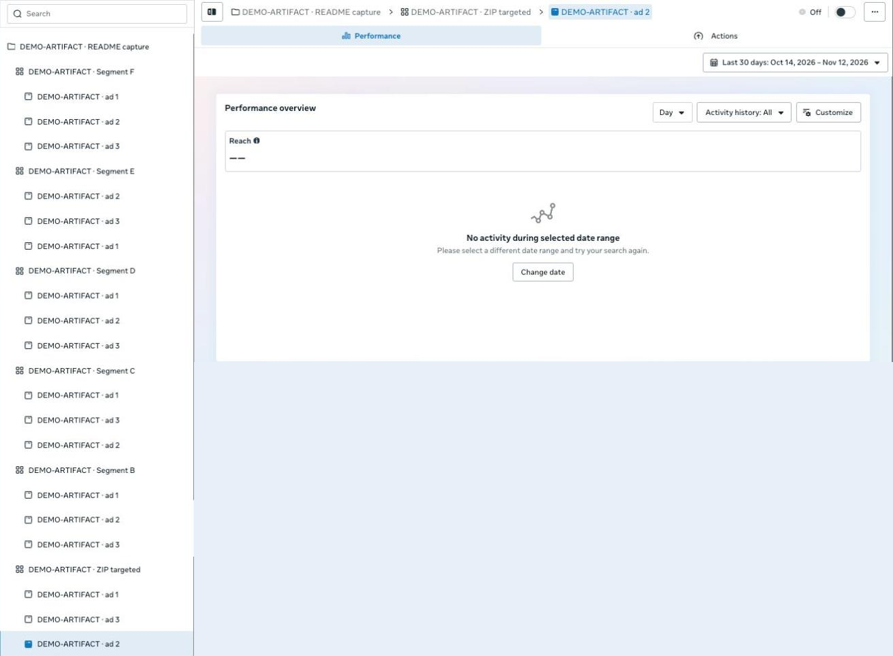

# meta-campaign-builder

> Builds Meta campaigns, ad sets, creatives and ads programmatically — paused, validated, and
> ready to review. Written for lead generation, not ecommerce.

A Python client over the Meta Marketing API (v25.0) that covers the whole launch path:
campaign → ad set → creative upload → placement-customized creative → ad. Crops one 9:16 master
into every placement, uploads it, and assembles multi-text creatives so you can test copy without
dynamic creative taking the wheel.

Everything it creates is **PAUSED**. It never launches anything.



## The problem

Building a real test in Ads Manager is an afternoon of clicking. Six ad sets, three creatives
each, four copy variants, placement crops for feed and story and reels — and then you do it again
next week for the next geo.

So you look for a way to script it. What you find is written for ecommerce: purchase events,
ROAS, catalog feeds, broad national targeting. Lead generation needs other things. ZIP-level
targeting that doesn't fall over when forty of the ZIPs are invalid. `LEAD` conversion events on
a pixel that hasn't fired one yet. Copy variants you control, because in a regulated vertical you
can't let the platform recombine your headlines.

And the real fear with any write-capable script: that it launches something while you're not
looking.

## What it does

**The full launch path, in code.** `create_campaign` → `create_adset` / `create_adset_with_zips`
→ `upload_image` / `upload_video` → `create_pac_creative` → `create_ad`. Plus listing and
inspection for pages, pixels, audiences, images and videos.

**One master asset, every placement.** `smart_crop_image.py` and `smart_crop_video.py` take a
9:16 master and produce the placement variants; `multi_aspect_upload.py` pushes them and returns
the hashes and video IDs the creative builders need.

**Multi-text without dynamic creative.** `create_image_creative_multitext` and
`create_video_creative_multitext` build creatives carrying several primary texts, headlines and
descriptions that *you* specified — so you test copy deliberately instead of handing Meta a bag
of parts.

**ZIP targeting that survives real ZIP lists.** `create_adset_with_zips` chunks at Meta's 2,500
limit and, on rejection, re-runs as a dry run to identify and drop the invalid entries rather
than failing the whole ad set.

## Safety posture

This tool has write access to ad accounts. The defaults are built for that:

- **`status="PAUSED"` is the default argument** on `create_campaign`, `create_adset` and
  `create_ad` — not a convention in the docs, the actual function signature. Going live is a
  separate, explicit `update_status` call.
- **`validate_only=True`** sends the payload through Meta's validator via `execution_options`
  without creating anything. Use it on any targeting spec you haven't run before.
- **Test one before you build fifty.** Create a single ad set, inspect it in the UI, then loop.
- **No pixel or conversion writes.** Read-only on both.
- **No audience management** beyond listing.

## Install

```bash
pip install -r scripts/requirements.txt    # requests; opencv-python for video crops
export FACEBOOK_TOKEN=...
python3 -c "from scripts.meta_client import MetaClient; print(MetaClient(account_id='0').list_ad_accounts())"
```

## Use

```python
from scripts.meta_client import MetaClient
m = MetaClient(account_id="XXXXXXXXXXXXXXX")   # bare ID, no act_ prefix

camp = m.create_campaign(name="Q4 · Annuity · CA", objective="OUTCOME_LEADS")   # PAUSED
adset = m.create_adset_with_zips(
    name="CA · 55-70 · ZIPs",
    campaign_id=camp,
    zips=["90210", "92101", ...],
    pixel_id="XXXXXXXXXXXXXXX", page_id="XXXXXXXXXXXXXXX",   # lead ad sets need both
    daily_budget_cents=5000,
)   # the ZIP wrapper runs its own dry-run bisection; don't pass validate_only here
```

Full worked examples — PAC creatives, video, placement crops — in `examples/`.

## Bring your own token

| Variable | Needs |
|---|---|
| `FACEBOOK_TOKEN` | `ads_management` for writes, `publish_video` for video upload. A System User token from Business Manager is the right instrument — it doesn't die with a login session. A Graph API Explorer token works for an hour. |

Nothing ships with a token, an account ID, a page ID or a pixel ID. `whoami()` tells you what
yours can see.

## What this will not do

- **Launch anything.** Everything is created paused, by default, in the signature.
- **Generate creative.** It crops, uploads and assembles assets you already have; it doesn't
  design images or write copy. That's the stage before this one.
- **Optimize.** No bid or budget logic, no automated rules. It builds; it doesn't decide.
- **Work as-is for ecommerce.** The defaults assume a lead objective. Catalog, DPA and purchase
  flows aren't covered.

## What it cost to get here

Not a warning. Just the bill, so you can decide whether to run this or build it.

- **Meta caps `age_max` at 65.** Five ad sets failed on a bare `Invalid parameter` (subcode
  1487843) with nothing useful in the message. The real error, `INVALID_AGE_MAX`, only surfaced
  after copying the targeting spec off an ad set that *had* worked and diffing it. Half a day.
- **`auto_filter_invalid` doesn't catch non-numeric ZIPs.** A single `ABCDE` in the list returns a
  different error shape than an invalid-but-numeric ZIP, so the bisection never trips. Numeric-only
  input, validated before the call.
- **Multi-text belongs on the ad, never the ad set**, and `is_dynamic_creative` has to be
  explicitly `false` or Meta recombines your headlines — which, in a regulated vertical, is how you
  end up with a claim nobody approved.
- **One material change per 72 hours.** Editing a live ad set resets learning. The ask-for-
  forgiveness version of this costs a week of delivery.
- **The API version moves.** This is written against v25.0. The targeting shapes are the part that
  breaks.

Running it weekly across several verticals is a command. Getting to the command was the work.

## Measurement — what this moves

Time from a finished creative pack to a reviewable paused campaign, and how many test cells you
can afford to build. When a six-ad-set test costs twenty minutes instead of an afternoon, you run
the test you actually wanted.

## License

MIT

---

## Where this comes from

`meta-campaign-builder` is the launch stage of the campaign pipeline I run at
[CallReady](https://callready.io) — research → avatars → statics → video → copy variants →
**launch** → optimize.

Each stage solves its own problem, so this one stands alone. You don't need the rest of the
pipeline to use it.

Built by **Keenan Shaw**. I build the audiences and the follow-up systems behind practices that
grow without buying their way there every month.
